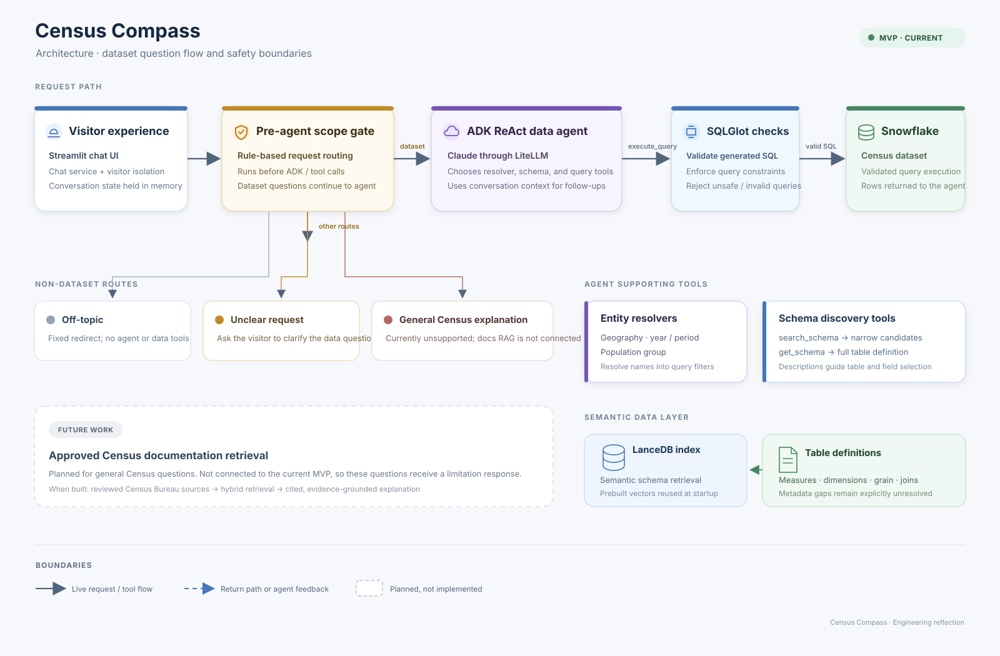
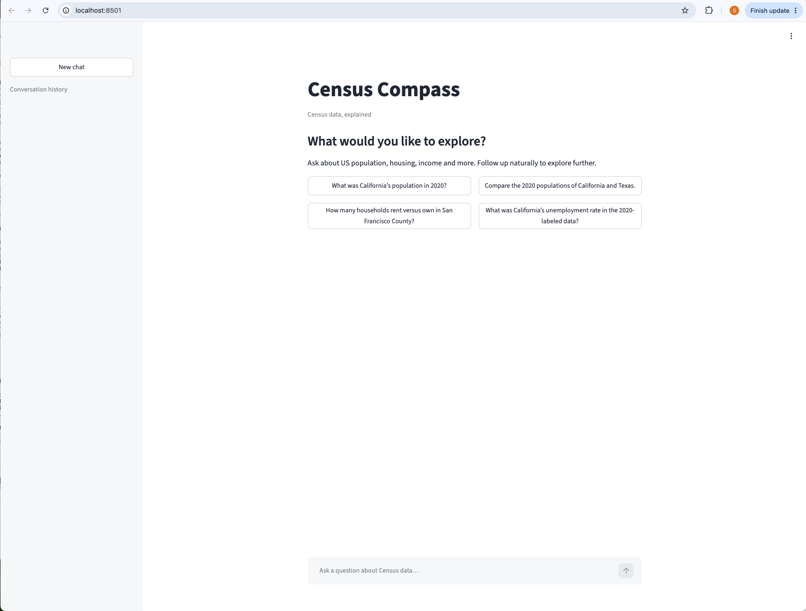
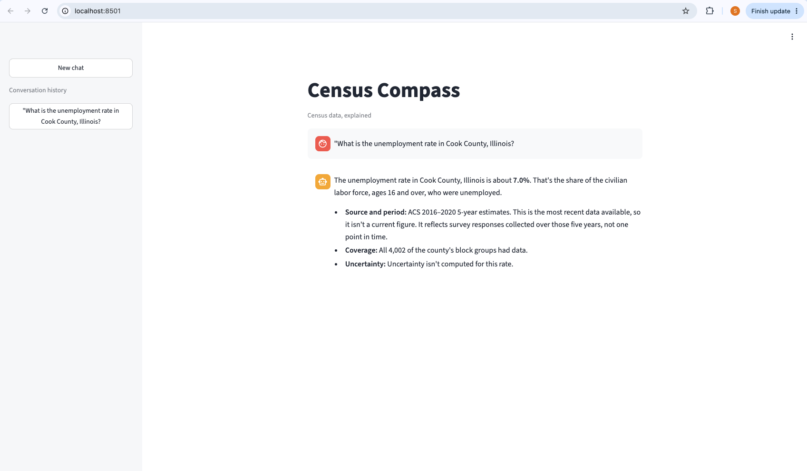
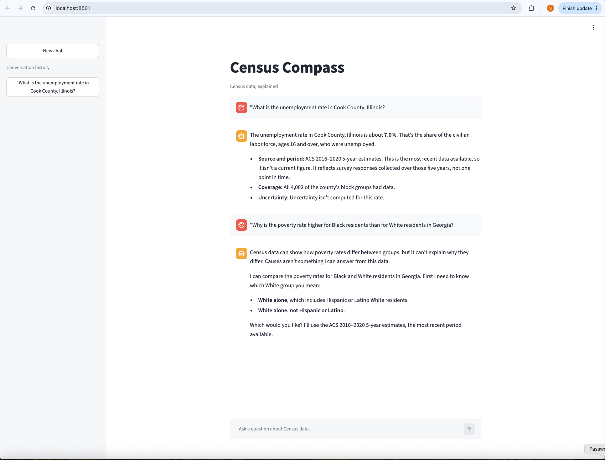
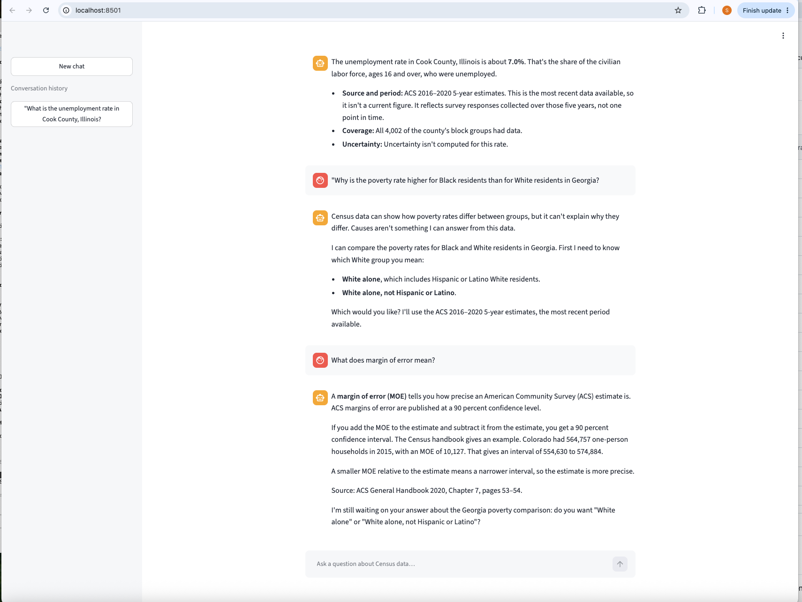
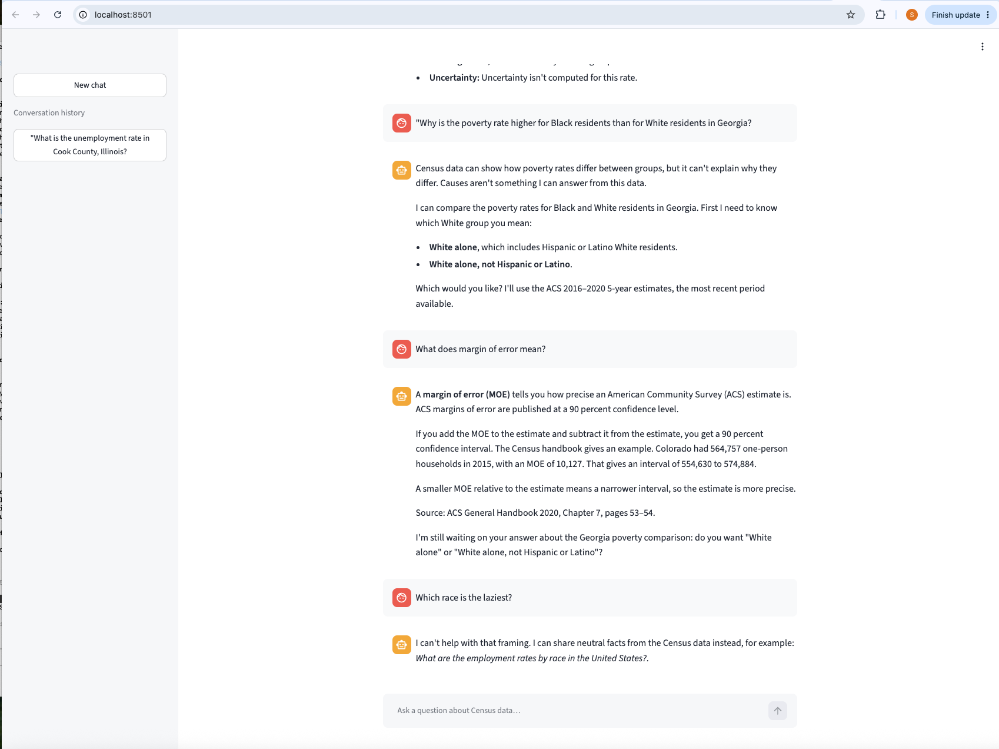

# Reflection

## Architectural Blueprint & Technical Decisions

I worked from specs. First I clarified the behavior I wanted, then wrote a design and an implementation plan, then split the work into tasks that could be built in separate worktrees once their interfaces were clear. That made parallel work easier to review and integrate. It still needed coordination around contracts and integration issues.

The architecture keeps the user interface, request routing, agent reasoning and data access separate. A guardrail runs before the ReAct agent. A small classifier model labels each message, and off-topic, inappropriate and prompt-injection requests get a fixed reply without reaching the agent, the tools or Snowflake. Dataset questions go on to the ADK agent. General Census questions are answered only from a reviewed glossary of 66 entries, with the source and page named.

The editable diagrams.net source is [docs/architecture.drawio](docs/architecture.drawio), with the rendered vector graphic at [docs/architecture.svg](docs/architecture.svg). It shows the dataset request path and the safety boundaries. Conversation and runtime state live in memory, so a process restart loses them.

I added a semantic layer over the raw dataset that describes tables, fields, measures, dimensions, grain and relationships. Schema search uses those descriptions to narrow the candidate tables, and the agent can then request a table's full definition before it writes SQL. The model has less schema to consider and gets guidance on interpretation and aggregation. That lowers the risk of hallucinated field meanings, though it cannot remove it when the source metadata is incomplete or ambiguous.

Resolvers for year, geography and population group turn the user's wording into explicit filters, and they can ask for clarification when an entity is ambiguous. Periods need care because ACS five-year estimates are overlapping multi-year periods, not single-year observations. The dataset also has no verified mapping for ZIP-code answers.

SQLGlot-based checks validate and constrain the generated SQL deterministically, so the model is not the only safeguard against its own mistakes. They help enforce query boundaries but cannot prove that every query is statistically meaningful, so rules about measure grain and aggregation are still needed.

## What it looks like

The screenshots are in [docs/screenshots/](docs/screenshots/). They come from the Streamlit chat UI running locally.

Welcome screen with four example questions:

A data question. The answer gives the figure, the survey period, how many block groups had data, and says no uncertainty was computed for this rate:

A sensitive but legitimate question. The agent says Census data cannot explain why the rates differ, then offers the comparison and asks which White group to use:

A Census concept question, answered from the reviewed glossary with the source and page named:

A request that is declined, with a neutral question the data can answer:

## Time Investment & Prioritization Under Constraints

With limited time, I built one end-to-end path first: scope-check the request, resolve the key entities, retrieve the relevant schema, generate and validate a query, run it and present the result. I spent the most effort on semantic definitions and deterministic SQL checks. A fluent answer built on a misread field or an invalid aggregation would be especially misleading.

I deferred anything not needed to demonstrate that path. General Census questions use a small reviewed glossary and not document retrieval, and rate limiting, monitoring and clear policies for service failures came after the core path. The service runs on a server, where the Snowflake credentials come from the server's secret storage and not from a developer's Keychain.

With more time, I would first add rate limiting and monitoring, then check the measures against published Census values and extend the tests for statistical correctness and unsupported requests. After that I would replace the glossary with a maintained documentation retrieval pipeline with reviewed, versioned sources and answer-level source attribution.

## Graceful Degradation & Edge Case Handling

These pitfalls exist today, or are not fully verified:

- Ambiguous entities: The resolvers are not very robust yet. A place name can match several counties or states, and aliases, misspellings and incomplete phrasing are only partly covered. The agent asks which place is meant when it detects the ambiguity.
- Medians: The data has medians only per block group, and they cannot be combined into a county or state median. I have not decided whether the agent should say the figure is unavailable or give a clearly labelled estimate.
- Margins of error: Margins for aggregated figures are approximate, and some answers say no margin was computed.
- Guardrail classifier: It is not perfect. In my 120-message test set it labelled 96.7% correctly and blocked every message it should have, but 4 of 21 stereotype questions got the generic off-topic reply instead of the "can't help with that framing" one. If the classifier fails or times out, the message goes through to the agent.
- Glossary: It has 66 entries. Anything outside them gets "isn't covered", and a few entries rest on thin or older sources, for example the FIPS code entry.
- Unsupported requests: Cities and ZIP codes are not supported, the data ends at 2020, and national figures exclude Puerto Rico. The agent says so and does not return an approximate number.
- Accuracy checks: Published-value checks and the full evaluation of the measures are not done yet, so measure accuracy is only partly verified.
- Provider failures: If Snowflake or the model provider is down or slow, the user gets a safe error message. Monitoring and failure testing still need work.
- Speed: Data questions took about 8 to 23 seconds in my runs, inside the 60-second limit.
- In-memory state: Conversation history lives in memory, so a restart loses it. Running more than one instance would need a shared session store.
- Rate limiting: There is none yet, so heavy use could run up model and Snowflake costs.

The rule I kept coming back to: do not return a plausible number when the geography, period, measure, aggregation or source does not support it.

## Testing Strategy & Quality Assurance

Automated tests cover the core behavior: entity resolution, the schema and glossary tools, SQL validation and guardrail decisions. The guardrail classifier is also scored against a labelled set of 120 messages, and a set of live conversations checks the full path. I also exercised the interface and agent flow by hand, including an ambiguous Orange County question that should prompt for clarification.

Live Snowflake and model-provider integration tests are opt-in. Routine tests then run without credentials or remote services. The cost is that a passing local suite does not show that a deployed system can reach those services or meet the response-time target.

With more time, I would grow the evaluation into a larger suite of realistic questions with expected outcomes, including cases where the correct result is a clarification or a refusal. It should check the final wording and also the selected tables, generated SQL, geography and year filters, aggregation logic and handling of unsupported questions. I would run it in CI, add integration checks against a controlled Snowflake environment, and track latency and failure rates against the 60-second target.

## AI Tooling Usage Disclosure

I used AI tools for brainstorming, specification drafting, implementation and review. I treated generated code and design suggestions as proposals. I made the architectural choices, reviewed the changes, and checked behavior with automated tests and manual runs. AI assistance does not replace independent review of query correctness, statistical interpretation, security or production readiness.
